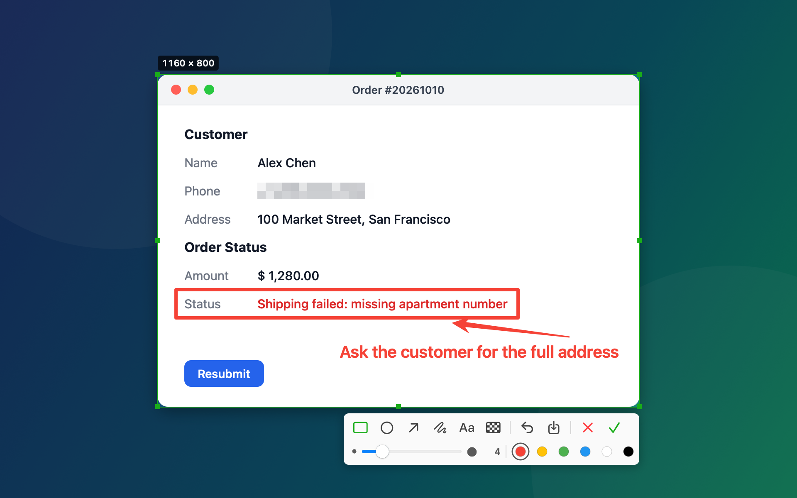

# Snipnote

[中文](README.zh-CN.md) | **English**

A lightweight menu bar screenshot tool for macOS: select a window or region, annotate it, and press Return — the image is on your clipboard, ready to paste into a chat, an email or a document.

<p align="center"></p>

## Download

**[⬇ Download Snipnote for macOS](https://github.com/yuting-ai/Snipnote/releases/latest/download/Snipnote.dmg)**

macOS 14 or later · Apple silicon & Intel · Notarized by Apple · Free and open source (MIT)

Website: [lepton.me/snipnote](https://lepton.me/snipnote) · All versions and release notes: [Releases](https://github.com/yuting-ai/Snipnote/releases)

## Features

- **Smart window detection**: hover to highlight a window and click to select it (click the desktop for the whole screen), or drag to capture any region and adjust its edges.
- **Six annotation tools**: rectangle, ellipse, arrow, pen, text and mosaic, with a slider for line width (font size for text) and a color palette.
- **Edit anything**: click an annotation to move it or change its size and color, press `⌫` to delete it, double-click text to edit it, and `⌘Z` to undo. New annotations are selected automatically so you can tweak them right away.
- **Straight to the clipboard**: press Return or double-click the selection to copy. `⌘S` also saves a PNG to the Desktop.
- **Custom shortcut**: `⌃⌥A` by default — change it to anything you like. Snipnote warns you if it clashes with a system shortcut.
- **Multi-display and Retina**: works on every display and exports at native resolution.
- **English and Chinese**: follows your system language, or switch it in Settings.
- **Tiny and quiet**: lives in the menu bar and can launch at login. No network access, no data collection.

## Requirements

- macOS 14 or later (Apple silicon or Intel)

## Install

1. [Download Snipnote.dmg](https://github.com/yuting-ai/Snipnote/releases/latest/download/Snipnote.dmg), open it, and drag Snipnote into Applications.
2. Open Snipnote. It has no window or Dock icon — look for the scissors icon in the **menu bar** at the top right of the screen.
3. On your first capture, macOS asks for permission: turn on Snipnote in System Settings → Privacy & Security → Screen & System Audio Recording, then **quit and reopen** Snipnote (the permission takes effect after a restart).
4. Press `⌃⌥A` to take a screenshot.

> **Why Screen Recording permission?** macOS requires it for any app that captures the screen. Snipnote has no network access — screenshots only go to the clipboard, or to the Desktop when you press `⌘S`.

## Usage

| Action | What it does |
|---|---|
| `⌃⌥A` | Start a capture (or click the scissors icon in the menu bar) |
| Hover + click | Select the window under the pointer |
| Drag | Select a region; drag an edge or corner to resize, drag inside to move, arrow keys to nudge (hold `⇧` for 10 points) |
| Toolbar | Pick an annotation tool; the second row sets width / font size and color. Click the active tool again to go back to moving the selection |
| Click an annotation | Select it to drag, nudge, change width / font size and color, or press `⌫` to delete |
| Double-click text | Edit the text |
| `↩` / double-click / ✓ | Finish and copy to the clipboard |
| `⌘S` / Save button | Copy to the clipboard and save a PNG to the Desktop |
| `⌘Z` | Undo |
| `Esc` / right-click | Cancel (with a selection but no annotations, right-click clears the selection first) |

Text tool: click to start typing, press `↩` or click elsewhere to finish, `⌥↩` for a new line. Line width and font size are remembered for the next capture.

The menu bar menu also has:

| Menu item | What it does |
|---|---|
| Settings… | Change the capture shortcut and the interface language |
| Launch at Login | Open Snipnote automatically when you log in |

## FAQ

**The shortcut doesn't do anything?**
Another app may be using it. Click the scissors icon → Settings… and choose a different combination. If it clashes with a system shortcut, the Settings window tells you where to turn that one off.

**I granted Screen Recording, but capturing still fails?**
The permission only takes effect after Snipnote restarts. Quit Snipnote from the menu bar and open it again.

**Too much mosaic?**
Press `⌘Z`, or deselect the mosaic tool, click the mosaic stroke and press `⌫`.

## Uninstall

Quit Snipnote from its menu bar menu and drag it from Applications to the Trash. If you turned on Launch at Login, untick it in the menu first.

## Development

Requires the Xcode command line tools (Swift 5.9 or later). There is no Xcode project.

```bash
./build.sh            # build and package build/Snipnote.app
./build.sh --install  # same, then install to /Applications, enable launch at login and relaunch
```

`build.sh` signs with the Apple Development certificate in your keychain, so the Screen Recording permission survives rebuilds. Set `SIGN_IDENTITY` to use a different certificate.

Quit the installed Snipnote before running a development build, or you'll see two icons in the menu bar.

| File | Contents |
|---|---|
| `Sources/Snipnote/AppDelegate.swift` | Menu bar icon and menu, shortcut registration, launch at login |
| `Sources/Snipnote/CaptureController.swift` | One capture session: overlay windows on every display, copy, save |
| `Sources/Snipnote/OverlayView.swift` | Selection, resizing, annotation interaction and export |
| `Sources/Snipnote/Annotation.swift` | Annotation model, drawing and hit testing |
| `Sources/Snipnote/Toolbar.swift` | The toolbar |
| `Sources/Snipnote/ScreenCapturer.swift` | ScreenCaptureKit capture and window positions for detection |
| `Sources/Snipnote/HotKey.swift` | Carbon global hotkey |
| `Sources/Snipnote/Shortcut.swift` | Shortcut storage, display names, validation and system-conflict check |
| `Sources/Snipnote/SettingsWindow.swift` | Settings window and the shortcut recorder |
| `Sources/Snipnote/L10n.swift` | All interface text in Chinese and English |
| `Sources/Snipnote/Snapshot.swift` | Renders the demo screenshots |

### Screenshots and icon

The screenshots in this README are rendered from a made-up window, so no real screen content appears. Regenerate both languages after changing the interface:

```bash
build/Snipnote.app/Contents/MacOS/Snipnote --snapshot docs/images
```

The app icon `Resources/AppIcon.icns` and the DMG background `Resources/dmg-background.tiff` are drawn by a script:

```bash
swift scripts/make-assets.swift
```

### Localization

All interface text lives in `Sources/Snipnote/L10n.swift`, each string written as `t("中文", "English")`.

### Releasing

`./build.sh --release` does it all in one command: universal build (Apple silicon + Intel) → Developer ID signing with the hardened runtime → DMG with a background → notarization and stapling → Gatekeeper check. The output is `dist/Snipnote-<version>.dmg`, plus a copy at `dist/Snipnote.dmg`.

The DMG is built with [dmgbuild](https://github.com/dmgbuild/dmgbuild), installed automatically into `.build/dmgbuild-venv` on first run. The layout is in `scripts/dmg-settings.py`.

Before the first release, store the notarization credentials in your keychain (requires an app-specific password for your Apple ID):

```bash
xcrun notarytool store-credentials Snipnote --apple-id <Apple ID> --team-id 3TJQ367JDZ
```

To release a new version, update `CFBundleShortVersionString` in `Info.plist`, then run:

```bash
./build.sh --release
```

Publish to GitHub. Always upload the DMG as `Snipnote.dmg` so the download link (`releases/latest/download/Snipnote.dmg`) points to the latest version:

```bash
gh release create v1.1 dist/Snipnote.dmg --title "Snipnote 1.1" --notes "…"
```

## License

Snipnote is released under the [MIT License](LICENSE).
