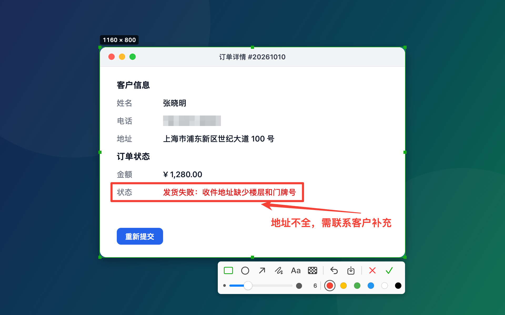

# SnapMark

轻量的 macOS 菜单栏截图工具，交互参考微信截图。截图完成后自动复制到剪贴板。

<p align="center"></p>

## 下载

**[⬇ 下载 SnapMark（macOS）](https://github.com/yuting-ai/SnapMark/releases/latest/download/SnapMark.dmg)** · 介绍页：[lepton.me/snapmark](https://lepton.me/snapmark)

macOS 14 或更高版本 · Apple 芯片和 Intel 均可 · 已通过 Apple 公证 · 免费开源（MIT）

## 使用

| 操作 | 说明 |
|---|---|
| `⌃⌥A` | 开始截图（默认快捷键，可在菜单栏「设置…」里修改；也可以点菜单栏的剪刀图标） |
| 悬停 + 单击 | 自动选中鼠标下的窗口（在桌面上单击是全屏） |
| 拖动 | 框选区域；拖边或角调整大小，拖内部移动，方向键微调（⇧ 每次 10pt） |
| 工具条 | 矩形 / 椭圆 / 箭头 / 画笔 / 文字 / 马赛克，第二行用滑块调粗细（文字是字号）和颜色 |
| 点击已有标注 | 选中（虚线框），可以拖动、方向键微调、用滑块改粗细/字号、换颜色，`⌫` 删除 |
| 双击已有文字 | 重新编辑文字内容 |
| `↩` / 双击选区 / ✓ | 完成，复制到剪贴板 |
| `⌘S` / 保存按钮 | 复制到剪贴板，同时保存 PNG 到桌面 |
| `⌘Z` | 撤销 |
| `Esc` / 右键 | 取消（有选区但还没标注时，右键会先清掉选区） |

界面支持中文和 English，在菜单栏「设置…」里切换（默认跟随系统语言）。

文字工具：单击开始输入，`↩` 或点别处结束，`⌥↩` 换行。字号用第二行的滑块调（12–72），输入时拖动会实时生效。新画的标注会自动选中，可以马上调大小。粗细、字号会记住，下次截图沿用。

## 构建

```bash
./build.sh            # 生成 build/SnapMark.app
./build.sh --install  # 编译后安装到 /Applications、开启开机自启并重新启动（以后更新也用这个）
./build.sh --release  # 分发版：Universal（Apple 芯片 + Intel）+ Developer ID 签名 + 公证 → dist/SnapMark-<版本>.dmg
```

### 分发版的公证凭证（只需设置一次）

1. 在 https://appleid.apple.com →「登录与安全」→「App 专用密码」生成一个密码
2. 运行下面的命令，按提示输入 Apple ID 和刚才的密码，凭证会存进钥匙串：

```bash
xcrun notarytool store-credentials "SnapMark" --apple-id <你的 Apple ID> --team-id 3TJQ367JDZ
```

之后 `./build.sh --release` 会自动提交公证、等待结果、把公证票据附加（staple）到 DMG 上。如果公证没有通过，会打印 Apple 返回的详细原因。
版本号取自 `Info.plist` 里的 `CFBundleShortVersionString`，发新版前记得改。

DMG 打开后是带背景和箭头的拖拽安装窗口，由 [dmgbuild](https://github.com/dmgbuild/dmgbuild) 生成（首次运行时自动装进 `.build/dmgbuild-venv`），布局在 `scripts/dmg-settings.py`。

### 图标和安装背景

`Resources/AppIcon.icns` 和 `Resources/dmg-background.tiff` 由脚本绘制，改样式后重新生成：

```bash
swift scripts/make-assets.swift
```

需要 macOS 14+。第一次截图时会请求「屏幕与系统音频录制」权限，授权后重新打开应用。
`build.sh` 默认用钥匙串里的 Apple Development 证书签名，所以重新编译后权限不会失效。可以用 `SIGN_IDENTITY` 环境变量指定其他证书。

## 代码结构

- `AppDelegate.swift`：菜单栏图标、快捷键、开机自启
- `HotKey.swift`：Carbon 全局快捷键
- `Shortcut.swift`：快捷键的保存、显示名、合法性和系统快捷键冲突检测
- `SettingsWindow.swift`：设置窗口（快捷键、语言）和快捷键录制按钮
- `L10n.swift`：所有界面文字的中英文
- `Snapshot.swift`：渲染演示截图（`SnapMark.app/Contents/MacOS/SnapMark --snapshot docs/images`），用虚构的窗口，不会出现真实屏幕内容
- `ScreenCapturer.swift`：ScreenCaptureKit 截屏，以及读取窗口位置用于自动识别
- `CaptureController.swift`：一次截图的完整流程：多屏遮罩窗口、复制、保存
- `OverlayView.swift`：框选、调整、标注交互，以及导出
- `Annotation.swift`：标注的数据模型和绘制
- `Toolbar.swift`：工具条

## 许可

[MIT](LICENSE)
